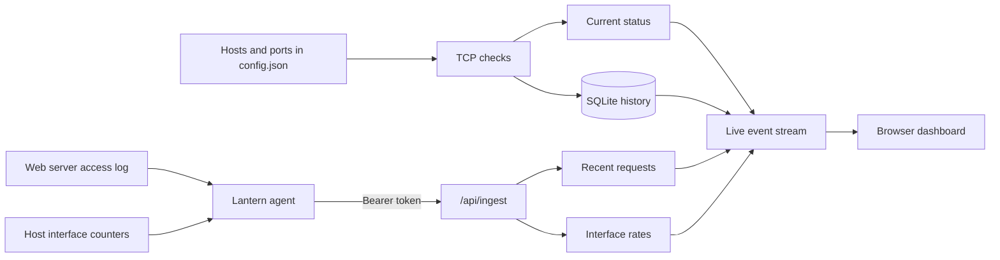

# How Lantern works

Lantern has two ways to collect data. The main app checks configured TCP ports. An optional agent runs on a web server and sends Lantern its access-log events and interface counters.

## Port checks

The poller tries to open a TCP connection to every configured host and port. It checks them concurrently, up to 32 at a time. A successful check means the port accepted the connection; it doesn't tell you whether the web page or application is healthy.

Current results stay in memory. Lantern writes a history row once a minute, and whenever a service changes between up and down. The database uses SQLite and removes old rows based on the retention setting.

## Agent data

The agent reads new lines from a JSON-lines access log and samples the machine's interface byte counters. It sends both to `/api/ingest` using the shared bearer token. Lantern keeps up to 250 recent request events and 60 interface samples per server in memory. That data clears when Lantern restarts.

For each request, Lantern records the client address the web server saw, the method, path, status, byte counts, and User-Agent. It leaves out query strings and request bodies. Interface readings are totals for the visible interfaces; they aren't packet captures or per-connection statistics. If you run the agent in Docker, it reports the container's network namespace.

## Dashboard and storage

The browser listens to `/api/events` for live updates. `/api/status` returns the current view, and `/api/history` returns hourly history buckets. The dashboard reuses its SQLite availability and latency aggregates for five seconds to avoid repeating the same query on every update.

`/healthz` checks whether Lantern is running. `/readyz` returns ready after the first round of port checks finishes.

## Access

Lantern only checks the hosts and ports you put in the config; it doesn't discover or scan devices. Agent ingestion stays off until `LANTERN_INGEST_TOKEN` is set. The dashboard has no login, so I keep it on localhost or a trusted home network. If you send agent data over an untrusted network, put the collector behind HTTPS.
